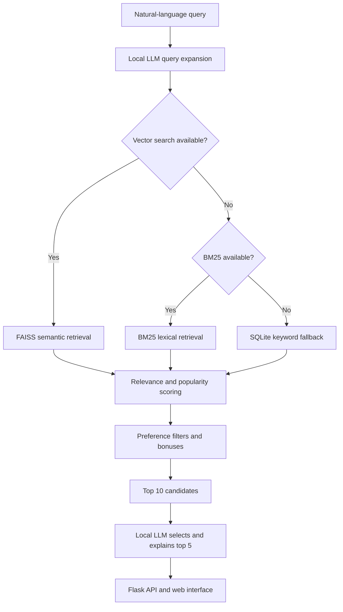

# Steam Game RAG Recommender

A local retrieval-augmented recommendation system for finding Steam games from natural-language requests. It combines semantic retrieval, lexical and SQL fallbacks, explicit preference handling, and locally hosted language models in a small Flask web application.

This repository contains the reproducible application code. The source SQLite database, generated BM25 cache, and FAISS index are intentionally excluded.

## What the system does

Given a request such as `a relaxing farming game without combat`, the application:

1. Expands the query into related Steam-style keywords using a local Ollama model.
2. Retrieves up to 50 candidates using the best available method:
   - FAISS semantic search when the vector index and embedding model are available.
   - BM25 lexical search when vector search is unavailable.
   - SQLite keyword matching as a final fallback.
3. Blends retrieval relevance with a logarithmic popularity signal.
4. Applies hard filters and small score adjustments for explicit constraints such as platform, price, and release era.
5. Sends the ten highest-scoring candidates to a local LLM, which selects five games and explains the recommendations.
6. Returns a stable JSON response to the Flask frontend. If the LLM is unavailable, the application returns score-ranked results with a template-based answer.

The retrieval methods form a fallback cascade; FAISS and BM25 scores are not combined in the same request.

## Architecture



## Dataset and index

The course dataset contains 39,176 Steam games and 7,679,845 English-language reviews collected through early April 2026. To reduce noise and indexing cost, the provided FAISS index was built for 18,449 games with more than 100 positive reviews.

Each indexed game document contains its name, description, genres, top tags, release date, rating information, and selected positive review snippets. Documents are embedded with `nomic-embed-text`, L2-normalised, and stored in a `faiss.IndexFlatIP` index so inner-product search is equivalent to cosine similarity.

The dataset is not redistributed in this repository because of its size and provenance. To run the project, provide a compatible SQLite database containing `games` and `reviews` tables.

## Technology

- Python 3.13 and `uv`
- Flask
- SQLite
- FAISS
- Ollama with `nomic-embed-text`
- Ollama with `phi4-mini`, Gemma, Phi, or another compatible local model
- BM25 and NLTK
- NumPy

## Repository layout

```text
.
|-- app.py                 Flask application and JSON API
|-- recommender.py         Retrieval, scoring, filtering, and generation
|-- build_index.py         Resumable FAISS index builder
|-- steam_sqlite.py        SQLite loading helpers
|-- tests/                 Preference parsing tests
|-- static/                Browser-side JavaScript and CSS
|-- templates/             Flask HTML template
|-- pyproject.toml         Project metadata and dependencies
`-- uv.lock                Reproducible dependency lock file
```

## Run locally

### 1. Install dependencies

Install [`uv`](https://docs.astral.sh/uv/) and run:

```bash
uv sync
```

### 2. Install the local models

Install and start [Ollama](https://ollama.com/), then pull the default models:

```bash
ollama pull nomic-embed-text
ollama pull phi4-mini
```

### 3. Configure the database

Either place `steam_games_reviews_25.sqlite` in the repository root or set `RAGLOOKER_DB_PATH` to its full path.

PowerShell example:

```powershell
$env:RAGLOOKER_DB_PATH = "D:\data\steam_games_reviews_25.sqlite"
```

### 4. Build the vector index

```bash
uv run python build_index.py
```

The builder checkpoints after each batch and resumes from an existing compatible index. Generated files are written to `vector_index/` and remain untracked.

### 5. Start the application

```bash
uv run flask --app app run --debug
```

Open `http://127.0.0.1:5000`.

## Tests

The current automated tests cover explicit preference detection and common substring false positives:

```bash
uv run python -m unittest discover -s tests -v
```

## Known limitations

- Query expansion and final explanation quality depend on the locally available LLM.
- The exact FAISS index only covers games above the positive-review threshold, so low-volume and newly released titles rely on fallback retrieval.
- Preference extraction is rule-based and does not cover every way a user can phrase a constraint.
- Score weights and preference bonuses were selected heuristically rather than learned from labelled relevance judgements.
- The generated-answer timeout stops waiting for the model but cannot cancel an Ollama request that is already running.
- Evaluation is currently qualitative; a future version should add a labelled query set and ranking metrics such as Recall@K and NDCG@K.

## Usage

This public copy is intended for portfolio and educational review. No open-source licence is granted, and the underlying Steam dataset is not included.

